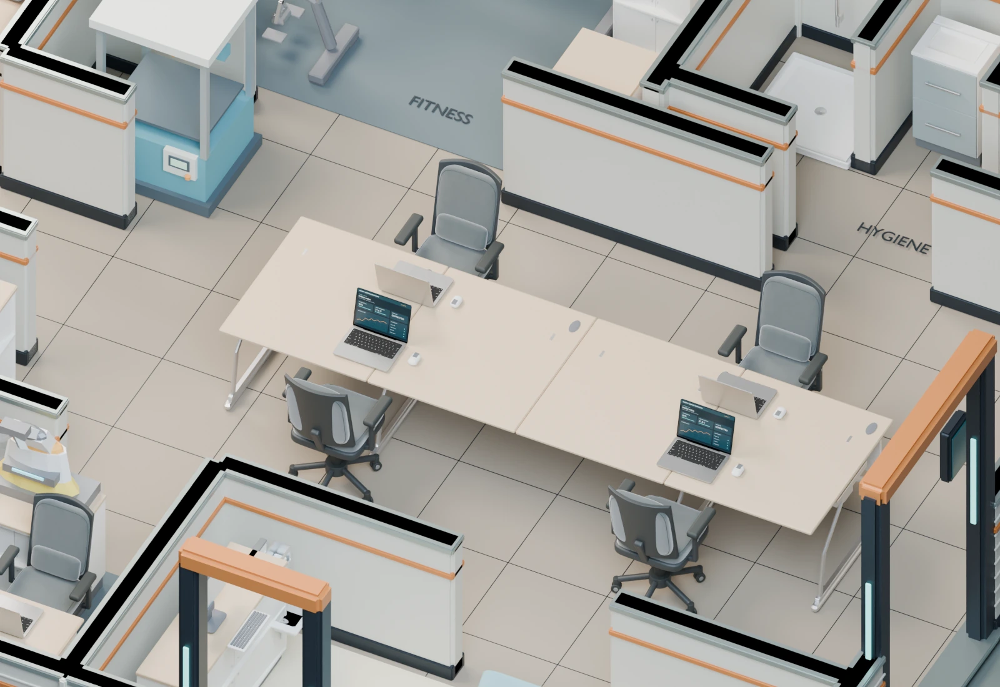
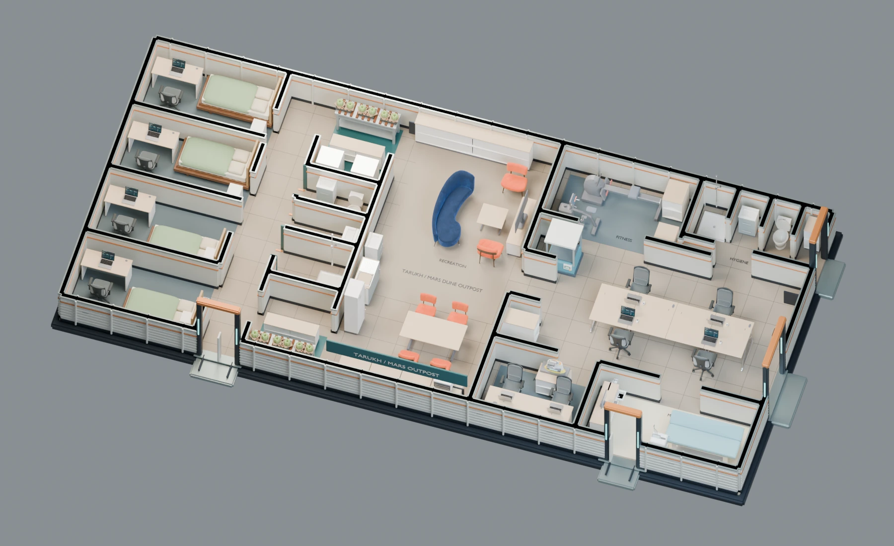
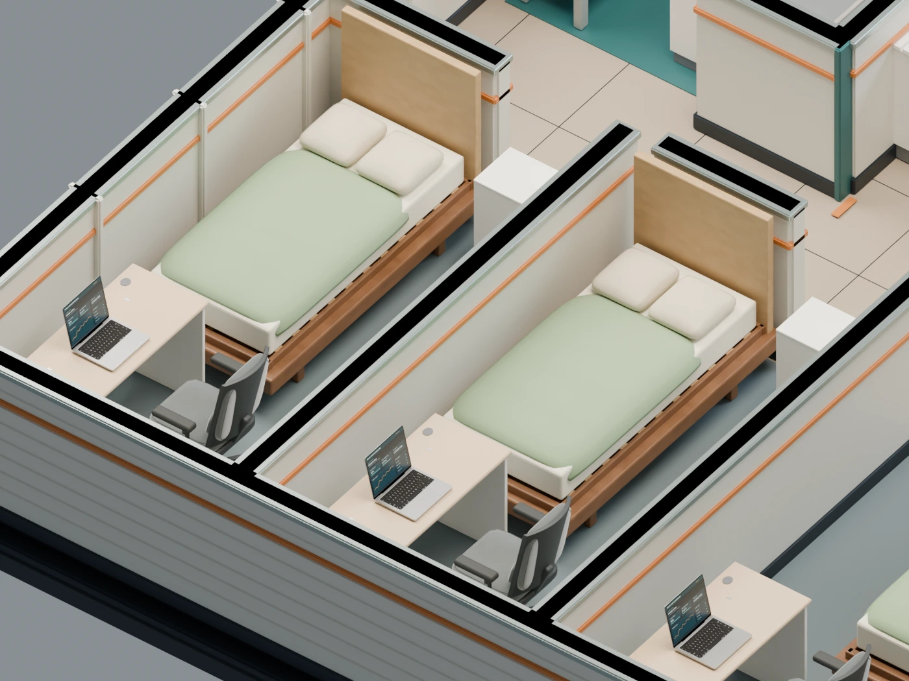

# TARUKH outpost review assets

A separate, furnished reconstruction of the supplied **Mars Dune Alpha** floor plan, using TARUKH's ivory, charcoal, amber and teal palette. The interior now uses **32 openly licensed models placed as 107 furniture and equipment instances**. These files are outside `public/` and are not imported by the game.



| File | Purpose | Size | Triangles |
| --- | --- | ---: | ---: |
| [tarukh-outpost-cutaway.glb](tarukh-outpost-cutaway.glb) | Furnished layout with walls cut to 1.12 m for inspection | 26.75 MB | 1,218,086 |
| [tarukh-outpost-full.glb](tarukh-outpost-full.glb) | Full-height building, furnished interior and removable roof | 27.94 MB | 1,271,238 |
| [build_outpost.py](build_outpost.py) | Reproducible Blender assembly and render script | — | — |
| [sources.json](sources.json) | Model authors, download URLs, licenses and SHA-256 hashes | — | — |

Sizes use decimal MB. Both GLBs contain their textures; no internet requests or separate texture files are needed to view them.



## Interior revision

The previous handmade furniture is replaced with downloaded models: open laptops with detailed keyboards and TARUKH display artwork, upholstered ergonomic chairs with castors and adjustable backs, timber beds with fabric bedding, a curved velvet sofa, tufted chairs, desks, cabinetry, appliances, sanitary fixtures, fitness equipment, a printer, a robot arm and medical equipment. The source library's material variants are reduced to the selected appearance.

Four crew quarters, two crop areas, the hygiene core, recreation, galley, fitness room, workroom, robotics and treatment areas retain their plan locations. Repeated objects share mesh/material data. Upper exterior ribs are hidden with the roof in the cutaway so they do not obstruct the interior.



The detailed chair, bed and sanitary assets are from Innerscene; the laptop is by Nicholas-3D; the lounge seating is by Eric Chadwick / Wayfair. Supporting equipment is from 3D Assets, whose contributor labels those models as AI-generated. Exact asset provenance and modifications are in [THIRD_PARTY.md](THIRD_PARTY.md). These models are not presented as entirely original TARUKH geometry.

## Scale and structure

The main shell is approximately **18.46 × 8.51 m**, inferred from the raster plan's scale bar. Full walls are 2.7 m high. Heights, roof design, equipment, door clearances and colours are artistic interpretations, not surveyed construction dimensions. Including entry steps, the model spans approximately 19.11 × 9.15 m; the mast reaches 4.2 m above the floor.

Named `ROOM_*`, `WALLS`, `ENTRIES`, `STRUCTURE` and `ROOF` groups support inspection and editing. Hide the full model's `ROOF` group to see inside. Blender uses Z-up; GLB uses standard glTF Y-up and metre units. Each furniture instance includes its source, author and license in node metadata.


## Materials and integration limits

The full GLB contains 133 metallic/roughness materials and 33 decoded textures, with normal maps, occlusion, fabric sheen, wood grain and emissive screens where supplied by the source assets. The exports use `EXT_texture_webp`, `KHR_materials_sheen`, `KHR_materials_clearcoat`, `KHR_materials_specular`, `KHR_materials_emissive_strength` and `KHR_texture_transform`. Texture maps are embedded PNG/WebP; the previews use WebP. Blender 5.2's direct WebP export drops some grayscale chair maps, so the assembly preserves those source maps.

The previews are Cycles studio renders. Viewer lighting affects the GLB's appearance; the GLBs do not include the presentation cameras or lights. Use environment lighting to show the materials correctly.

These are **detailed review models**, with 1,615 mesh instances in the cutaway and 1,886 in the full model. Gameplay integration needs batching/LODs, collision geometry, lighting and device testing. Static door openings have no animation, navigation mesh or collision behavior. The existing game's files and compiled JavaScript/CSS are unchanged.

## Rebuild

Use Blender 5.2.4 or a compatible version. All source models are included; rebuilding needs no downloads, game dependency changes or external service.

```sh
blender --background --python-exit-code 1 --python assets/outpost-review/build_outpost.py -- --output /path/to/export-folder --render --samples 64
```

Use a separate output directory to preserve the checked-in exports. The script checks source hashes, assembles both GLBs, verifies embedded image references, and saves packed editable `.blend` files. `--render` adds four PNG previews; omit it for export only. CUDA is used when available, with CPU rendering as the fallback.

`sources/architecture.glb` retains the earlier TARUKH shell with its old furnishings removed. `sources/surface-ops.svg` is the editable, original demonstration display; its PNG is embedded in the laptops. The display is static artwork, not a live telemetry service.

## Verification

Verified on **15 November 2026**:

- Executed the assembly in local Blender 5.2.4 and inspected the cutaway, operations desks, crew quarters and complete exterior renders.
- Khronos glTF Validator: **zero errors and zero warnings** for both GLBs. Informational notices concern unused UV/tangent attributes.
- Three.js 0.180 `GLTFLoader` in headless Chrome: both files load and render; all positions/bounds are finite, all 33 textures decode, all 14 room groups remain, and all 107 sourced instances retain metadata.
- Both GLBs have zero external image/buffer requests.
- Existing game: **136 tests**, TypeScript, Sites build and Pages build passed. All 16 existing Pages JS/CSS files match the pre-change hashes.
- ESLint still reports the existing **two errors and two warnings** in `MarsFreeRoam.tsx` and `MarsWorld.tsx`. No gameplay code was edited to suppress them.

The standalone asset was checked in Chrome and Blender. Physical-phone performance, gameplay integration and other 3D applications have not been tested.

## Reference and licenses

The layout follows the user-supplied Mars Dune Alpha floor-plan image; that image is not redistributed. Mars Dune Alpha is an **Earth-based CHAPEA analog habitat**, not a surveyed building on Mars. See [NASA CHAPEA](https://www.nasa.gov/humans-in-space/chapea/) and [BIG's project](https://big.dk/projects/mars-chapea-4310) for habitat context and ICON/BIG architectural attribution. This review is an artistic adaptation, not an official NASA/ICON/BIG model or certified habitat design. No endorsement is implied.

The laptop and sofa require **CC BY 4.0 attribution**; the other downloaded furnishings are **CC0**. Keep [THIRD_PARTY.md](THIRD_PARTY.md) and [sources.json](sources.json) with redistributed models. See also the repository's [asset credits](../../ASSET_CREDITS.md).
