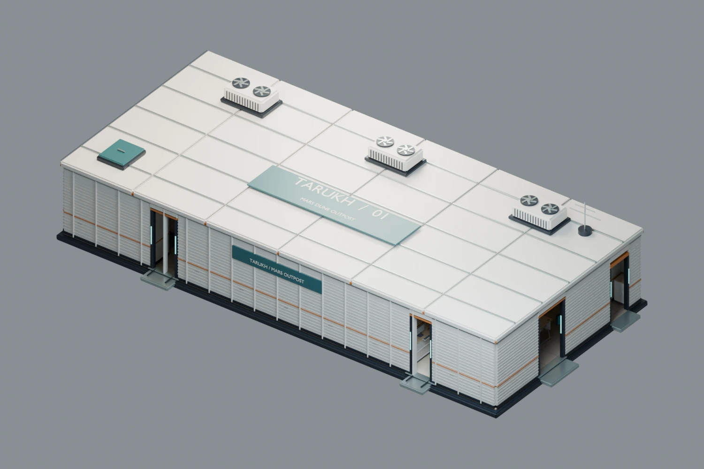

# TARUKH outpost review assets

Separate 3D assets reconstructed from the supplied **Mars Dune Alpha** floor plan, using TARUKH's ivory, charcoal, amber and teal palette. These files are outside `public/` and are not imported by the game.


| File | Purpose | Size | Triangles |
| --- | --- | ---: | ---: |
| [tarukh-outpost-cutaway.glb](tarukh-outpost-cutaway.glb) | Furnished layout with walls cut to 1.12 m for inspection | 5.72 MB | 256,096 |
| [tarukh-outpost-full.glb](tarukh-outpost-full.glb) | Full-height building, furnished interior and removable roof | 7.28 MB | 339,200 |
| [build_outpost.py](build_outpost.py) | Blender construction source for both variants | — | — |



## Model contents

Four crew quarters; two planted hydroponic racks; laundry, washrooms and showers; recreation and dining areas; galley; exercise equipment; four-terminal workroom; 3D printer; robotics bench; treatment room; storage and entry steps. The full version adds ribbed exterior walls, modular roof panels, ventilation packs, service conduits, a communications mast and ceiling lights.

The main shell is approximately **18.46 × 8.51 m**, inferred from the raster plan's scale bar. Full walls are 2.7 m high. Heights, roof design, equipment, furnishings, door clearances and colours are artistic interpretations, not surveyed construction dimensions. Including steps, the model spans approximately 19.11 × 9.15 m; the mast reaches 4.2 m above the floor.

Named `ROOM_*`, `WALLS`, `ENTRIES`, `STRUCTURE` and `ROOF` groups support inspection and future editing. Hide the full model's `ROOF` group to see inside. Blender uses Z-up; the GLBs use standard glTF Y-up and metre units.

## Materials and use

Both GLBs are self-contained, with 15 metallic/roughness materials and no external texture or model requests. Furniture, plants, typography and small hardware are geometry. Emission and presentation lights use `KHR_materials_emissive_strength` and `KHR_lights_punctual`.

These are **detailed review models**, not optimized runtime replacements: the full asset contains 2,029 mesh instances. Future gameplay integration needs batching/LODs, collision geometry, suitable lighting and performance testing. Doors are open static openings; no door animation, navigation mesh or collision behavior is included. The existing game remains unchanged.

## Rebuild

Use Blender 5.2:

```sh
blender --background --python assets/outpost-review/build_outpost.py -- --output /path/to/export-folder
```

The script creates both GLBs and editable `.blend` files. Use a separate output folder to preserve the checked-in review exports. No package or game dependency is needed. The hosted Blender export and local re-export may differ in metadata and optional UV attributes without changing the intended geometry.

## Verification

Verified on 14 November 2026 (UTC):

- Rendered and visually inspected the furnished layout and complete exterior.
- Corrected sealed central washrooms, lower crew-room access and keyboard/seat orientation.
- Khronos glTF Validator: **zero errors and zero warnings** for both GLBs. Informational notices concern unused UV coordinates.
- Three.js 0.180 `GLTFLoader`: both parse successfully, all positions/bounds are finite, all 14 room groups remain and the full model's roof has 170 children.
- The construction code ran in hosted Blender 5.2. The assembled local rebuild script was syntax-checked; local Blender execution was unavailable.
- Existing game checks on source revision `dfe30f0`: 136 tests, TypeScript, Sites build and Pages build passed. Existing ESLint findings remain (two errors and two warnings). No browser gameplay or physical-device performance claim is made for these review assets.

## Reference and attribution

The layout follows the user-supplied Mars Dune Alpha floor-plan image. The source image is not redistributed. Mars Dune Alpha is an **Earth-based CHAPEA analog habitat**, not a surveyed building on Mars. See [NASA CHAPEA](https://www.nasa.gov/humans-in-space/chapea/) and [BIG's Mars Dune Alpha project](https://big.dk/projects/mars-chapea-4310) for the original habitat context and ICON/BIG architectural attribution.

The meshes, furniture, roof interpretation and TARUKH material treatment were authored procedurally for this review in Blender through Higgsfield 3D Jutsu. They are an adaptation of that reference, not an official NASA, ICON or BIG model. No endorsement is implied. See the repository's [asset credits](../../ASSET_CREDITS.md).
